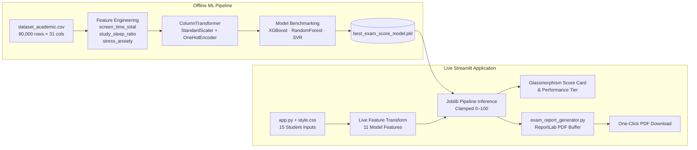

<div align="center">

# 🎓 Exam Score Prediction Engine

**End-to-End Student Performance Forecasting Platform with Real-Time Feature Engineering, Glassmorphism UI & Automated PDF Assessment Reports**

[](https://www.python.org/)
[](https://streamlit.io/)
[](https://scikit-learn.org/)
[](https://xgboost.readthedocs.io/)
[](https://www.reportlab.com/)


*Predict student exam scores from 80,000+ academic, lifestyle, and psychological records — complete with custom behavioral ratios and instant downloadable PDF performance reports.*

</div>

---

## ⚡ Overview

Academic outcomes are driven by the interplay of study habits, sleep hygiene, digital distractions, psychological pressure, and support environments. This repository delivers a **complete ML training pipeline and interactive Streamlit web application** that estimates a student's expected exam score (`0–100`) and generates a tailored, downloadable PDF assessment report in one click.

* **80,000-Record Training Pipeline** — Trained and benchmarked across `dataset_academic.csv` (80,000 rows × 31 features) using `XGBRegressor`, `RandomForestRegressor`, and `SVR`.
* **Domain Feature Engineering** — Synthesizes composite behavioral signals (`screen_time_total`, `study_sleep_ratio`, `stress_anxiety`) dynamically during both training and live inference.
* **Custom Dark Glassmorphism UI** — Styled via `style.css` with frosted-glass containers, `Space Grotesk` + `Inter` typography, and neon cyan-blue gradients.
* **Automated PDF Reporting** — `exam_report_generator.py` uses `ReportLab` to build timestamped, color-coded PDF assessment sheets with feature breakdowns and tiered study recommendations.

---

## 🏗️ System Architecture



---

## 🧬 Feature Engineering & Model Inputs

Rather than feeding noisy raw counters directly to the regressor, the pipeline consolidates 15 user inputs into **11 high-signal features** (7 numerical + 4 categorical):

### Engineered Composite Features
| Feature | Formula | Purpose |
| :--- | :--- | :--- |
| `screen_time_total` | `social_media_hours + netflix_hours + screen_time` | Captures total daily digital distraction load |
| `study_sleep_ratio` | `study_hours_per_day / sleep_hours` | Measures academic effort relative to rest recovery |
| `stress_anxiety` | `stress_level + exam_anxiety_score` | Combines general stress and exam-specific anxiety into a unified psychological load metric |

### Complete Inference Feature Schema
| Type | Features | Preprocessing |
| :--- | :--- | :--- |
| **Numerical (7)** | `previous_gpa`, `motivation_level`, `stress_anxiety`, `study_sleep_ratio`, `screen_time_total`, `time_management_score`, `attendance_percentage` | `StandardScaler` |
| **Categorical (4)** | `major` *(6 options)*, `study_environment` *(5 options)*, `parental_education_level` *(5 options)*, `diet_quality` *(3 options)* | `OneHotEncoder` |

---

## 🧠 Machine Learning Pipeline

The training notebook executes an end-to-end modeling workflow encapsulated in a single `scikit-learn` `Pipeline` so preprocessing and inference stay strictly synchronized without data leakage:

1. **Exploratory Data Analysis** — Distribution checks (`seaborn.histplot` + KDE) and multivariate feature correlation analysis across 80,000 student records.
2. **Preprocessing** — Unified `ColumnTransformer` applying `StandardScaler` to numerical features and `OneHotEncoder` to categorical attributes.
3. **Model Benchmarking** — Evaluates three regression architectures on held-out test splits using **R²**, **MSE / RMSE**, and **MAE**:
   * `XGBRegressor` (Gradient Boosted Trees)
   * `RandomForestRegressor` (Bagged Ensemble Trees)
   * `SVR` (Support Vector Regression)
4. **Serialization** — Exports the top-performing pipeline to `best_exam_score_model.pkl` via `joblib`.

---

## 📄 Automated PDF Assessment Engine

Every prediction triggers `exam_report_generator.py` (`ReportLab`) to render an in-memory PDF (`{student_name}_exam_score_report.pdf`) featuring a header banner, timestamp, full student profile table, color-coded score badge, and targeted academic advice:

| Predicted Score | Status Label | Report Badge Color | Actionable Guidance |
| :--- | :--- | :--- | :--- |
| **85.00 – 100.00** | 🌟 Excellent Performance | 🟢 Green | Maintain study consistency, regular revision, and lifestyle balance |
| **60.00 – 84.99** | 🙂 Good Performance | 🟠 Orange | Refine study techniques, target weak subjects, and leverage tutoring |
| **0.00 – 59.99** | ⚠️ Needs Improvement | 🔴 Red | Adopt structured schedules, increase teacher guidance, and reduce stress |

---

## 🛠️ Tech Stack & Tools

| Category | Tools & Libraries |
| :--- | :--- |
| **Core Language** | Python 3.10+ |
| **Web Framework & UI** | Streamlit, Custom CSS3 (`style.css`), Google Fonts (`Space Grotesk`, `Inter`) |
| **Machine Learning** | scikit-learn (`Pipeline`, `ColumnTransformer`, `RandomForestRegressor`, `SVR`), XGBoost (`XGBRegressor`) |
| **Data Processing & Serialization** | pandas, NumPy, Joblib |
| **EDA & Visualization** | Jupyter Notebook / Google Colab, Matplotlib, Seaborn |
| **PDF Generation** | ReportLab (`canvas`, `Table`, `Paragraph`, `Frame`) |
| **Developer Tooling** | Git, GitHub, VS Code |

---

## 📂 Repository Structure

```text
Examscore_perdction/
├── app.py                        # Streamlit web app, live feature engineering & inference UI
├── exam_report_generator.py      # ReportLab PDF assessment report builder
├── style.css                     # Dark glassmorphism & neon gradient stylesheet
├── best_exam_score_model.pkl     # Serialized scikit-learn/XGBoost preprocessing + model pipeline
├── dataset_academic.csv          # Academic performance dataset (80,000 rows × 31 columns)
├── Exam (1).ipynb                # EDA, feature engineering, model benchmarking & export notebook
└── README.md                     # Project documentation
```

---

## 🚀 Quick Start

### 1. Clone the Repository
```bash
git clone [https://github.com/SAIKARTHIK296/Examscore_perdction.git](https://github.com/SAIKARTHIK296/Examscore_perdction.git)
cd Examscore_perdction
```

### 2. Create & Activate a Virtual Environment
```bash
python -m venv venv

# Windows (PowerShell)
.\venv\Scripts\Activate.ps1

# macOS / Linux
source venv/bin/activate
```

### 3. Install Dependencies
```bash
pip install streamlit pandas numpy scikit-learn xgboost joblib reportlab matplotlib seaborn
```

### 4. Run the Application
```bash
streamlit run app.py
```
The dashboard launches automatically at `http://localhost:8501`. Enter a student's name, adjust the sliders and selectors, click **🔮 Predict Exam Score**, and download the generated PDF report via **📄 Download Report**.

---

## 🔄 Retraining the Model

1. Place your updated dataset as `dataset_academic.csv` in the project root.
2. Open the training notebook in Jupyter Notebook, VS Code, or Google Colab and run all cells.
3. Verify the evaluation metrics (`R²`, `RMSE`, `MAE`) and confirm `best_exam_score_model.pkl` is overwritten.
4. Restart `streamlit run app.py` to serve predictions from the newly trained pipeline.

---

<div align="center">
  Built by <strong><a href="https://github.com/SAIKARTHIK296">K A Venkata Sai Karthik</a></strong>
</div>
